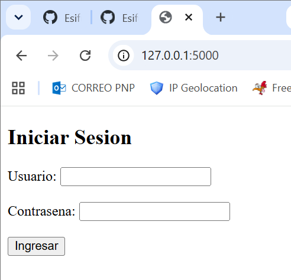
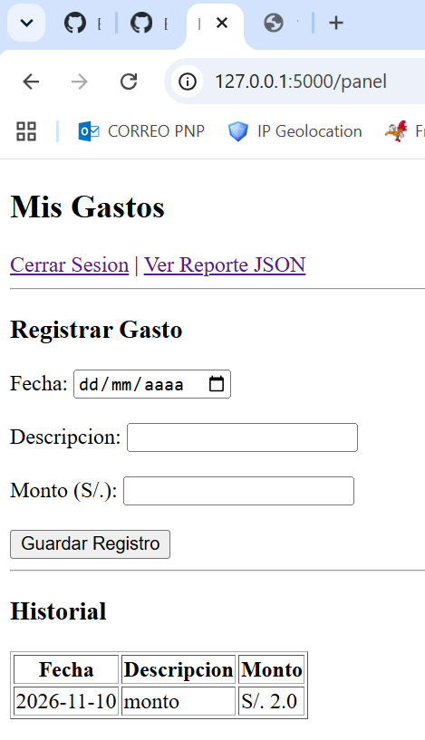
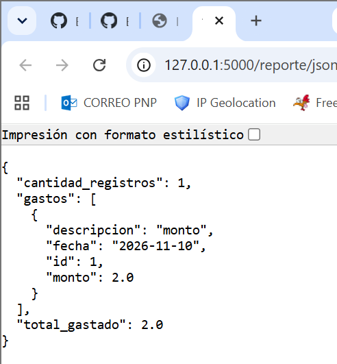
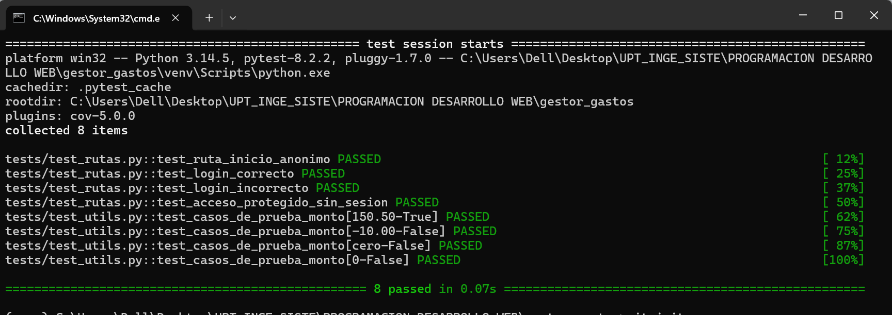

# Sistema de Gestion de Gastos Personales

Aplicacion web desarrollada con Python, Flask y SQLite para el control de finanzas personales, asegurando la calidad del codigo mediante pruebas automatizadas con pytest.

## Requisitos e Instalacion

1. Clonar el proyecto:
   ```bash
   git clone https://github.com
   cd gestor_gastos
   ```

2. Configurar el entorno virtual:
   ```bash
   py -m venv venv
   venv\Scripts\activate
   ```

3. Instalar dependencias:
   ```bash
   py -m pip install -r requirements.txt
   ```

## Funcionamiento de la Aplicacion

### 1. Control de Acceso (Login)
Para ingresar al sistema se requiere autenticacion:
- **Usuario:** admin
- **Contrasena:** 123



### 2. Panel de Registro de Gastos
Permite registrar un gasto ingresando:
- **Fecha**
- **Descripcion**
- **Monto** (Valido mediante pruebas unitarias mayor a cero).



### 3. Reporte en formato JSON
Expone un endpoint en `/reporte/json` que compila dinamicamente el monto acumulado.



---

## Ejecucion de Pruebas Automatica (pytest)

Para ejecutar la suite de pruebas unitarias y de rutas implementadas:

```bash
py -m pytest -v
```



